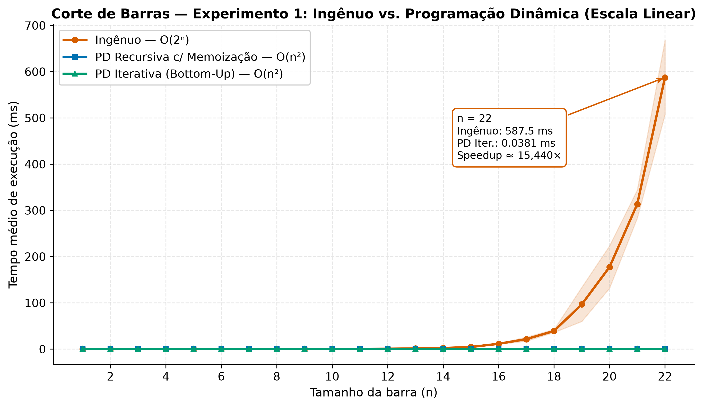
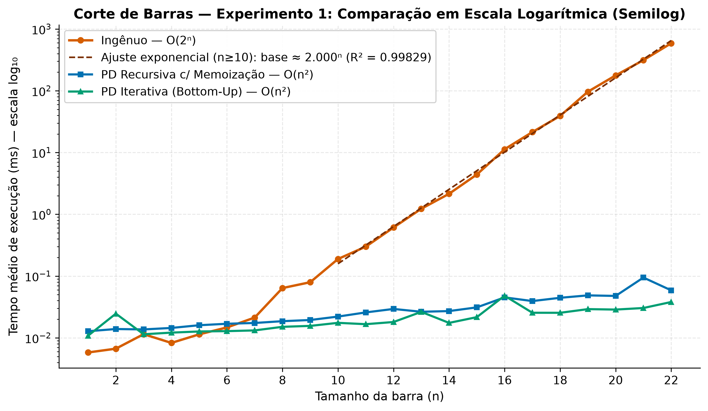
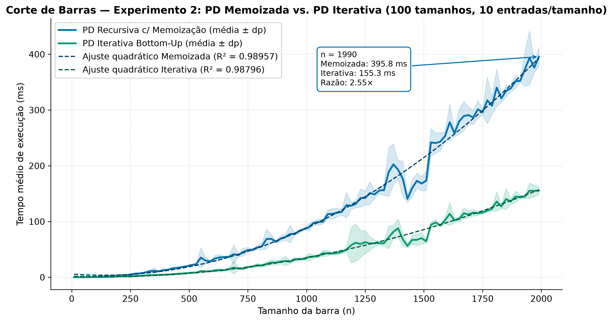
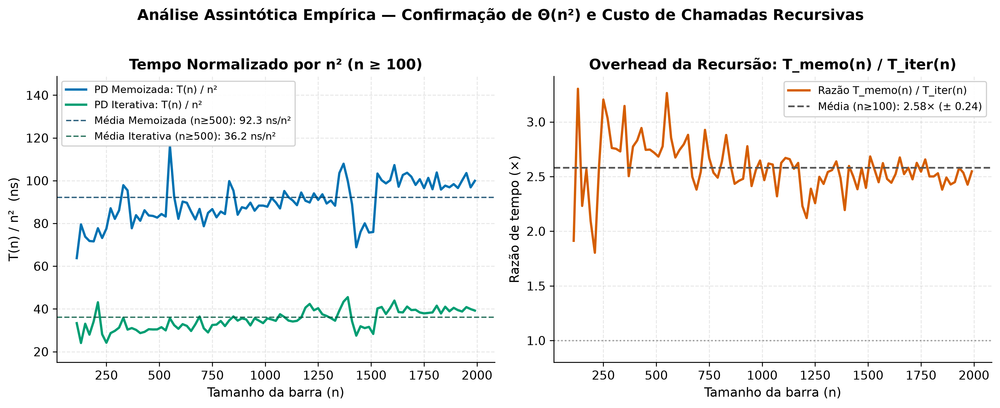

# Corte de Barras (Rod Cutting) — Análise Experimental

Experimento da disciplina de **Projeto e Análise de Algoritmos** (Tema **7.2 — Corte de Barras**).

* **Vídeo explicativo (YouTube):** https://youtu.be/EdKaLnjVWRw

## O Problema

Dada uma barra de comprimento inteiro $n$ e uma tabela de preços $p[1..n]$ (onde $p[i]$ é o preço de um pedaço de tamanho $i$), queremos encontrar a melhor forma de cortar a barra para maximizar o lucro total:

$$r(0) = 0, \qquad r(n) = \max_{1 \le i \le n}\big(p[i] + r(n - i)\big)$$

As implementações de Programação Dinâmica retornam tanto o **lucro máximo** quanto a **lista dos cortes** que geram esse valor.

## Algoritmos Comparados

Implementados em [`src/rod_cutting.py`](src/rod_cutting.py):

| Algoritmo | Função | Complexidade | Retorno |
| :--- | :--- | :---: | :--- |
| Ingênuo (força bruta recursiva) | `rod_cutting_naive` | $\Theta(2^n)$ | Lucro máximo |
| PD Recursiva c/ Memoização (Top-Down) | `rod_cutting_memoized` | $\Theta(n^2)$ | `(lucro_maximo, cortes)` |
| PD Iterativa (Bottom-Up) | `rod_cutting_iterative` | $\Theta(n^2)$ | `(lucro_maximo, cortes)` |

Nas duas versões de PD, o vetor `B` guarda o lucro ótimo de cada subproblema e o vetor `S` guarda o primeiro corte ótimo, usado ao final para reconstruir a sequência exata de pedaços em tempo $O(n)$. Na versão memoizada também aumentamos `sys.setrecursionlimit`, já que para $n \ge 1000$ a pilha ultrapassa o limite padrão do Python.


## Metodologia e Validação

* **Ambiente:** Intel Core i5-13420H, 23,71 GB RAM, Windows 11, Python 3.13.1 (afinidade fixada no núcleo 0 e medições com `time.perf_counter()`).
* **Geração de entradas (`src/generator.py`):** 10 tabelas de preços aleatórias e distintas por tamanho $n$, com incrementos inteiros em $[1, 10]$ e sementes fixas (`seed=42` no Exp. 1 e `seed=2026` no Exp. 2). Os algoritmos rodam sempre sobre as mesmas entradas, alternando a ordem de execução.
* **Experimento 1 (3 algoritmos):** $n = 1, 2, \dots, 22$ (220 instâncias). Acima de $n = 22$ o ingênuo já fica inviável.
* **Experimento 2 (apenas PD):** 100 tamanhos de $n = 10$ até $n = 1990$ com passo 20 (1.000 instâncias).
* **Corretude:** os algoritmos empataram no valor ótimo em **1.220 / 1.220 instâncias** (0 divergências), todos os cortes gerados pela PD foram validados (soma dos pedaços $= n$ e soma dos preços $= r(n)$) e a suíte de testes em [`tests/test_rod_cutting.py`](tests/test_rod_cutting.py) cobre a tabela clássica do CLRS e casos de borda (14/14 aprovados).

Exemplo de saída para $n = 10$ com $p = [6, 14, 22, 30, 34, 43, 51, 54, 56, 61]$:

```text
Ingênuo      -> lucro: 74
PD Memoizada -> lucro: 74 | cortes: [2, 4, 4]  (14 + 30 + 30 = 74)
PD Iterativa -> lucro: 74 | cortes: [2, 4, 4]  (14 + 30 + 30 = 74)
```

## Resultados

### Experimento 1 — Ingênuo vs. Programação Dinâmica ($n = 1..22$)

| $n$ | Ingênuo (ms) | PD Memoizada (ms) | PD Iterativa (ms) | Speedup (Iter. vs. Ingênuo) |
| ---: | ---: | ---: | ---: | ---: |
| 4 | 0,008 ± 0,000 | 0,0145 | 0,0122 | 0,7x |
| 8 | 0,064 ± 0,058 | 0,0186 | 0,0151 | 4,2x |
| 10 | 0,189 ± 0,106 | 0,0221 | 0,0175 | 10,8x |
| 12 | 0,612 ± 0,364 | 0,0294 | 0,0181 | 33,9x |
| 14 | 2,149 ± 0,311 | 0,0271 | 0,0175 | 123,0x |
| 16 | 11,309 ± 0,894 | 0,0452 | 0,0480 | 235,4x |
| 18 | 39,134 ± 3,192 | 0,0445 | 0,0254 | 1.537,7x |
| 20 | 177,337 ± 45,846 | 0,0477 | 0,0287 | 6.179,0x |
| 21 | 313,534 ± 30,588 | 0,0947 | 0,0304 | 10.303,5x |
| **22** | **587,482 ± 80,587** | **0,0588** | **0,0381** | **15.439,7x** |

Tabela completa em [`results/exp1_all_algorithms.csv`](results/exp1_all_algorithms.csv).





### Experimento 2 — PD Memoizada vs. PD Iterativa ($n = 10..1990$)

| $n$ | PD Memoizada (ms) | PD Iterativa (ms) | Razão ($T_{\text{memo}} / T_{\text{iter}}$) | $T_{\text{memo}}/n^2$ (ns) | $T_{\text{iter}}/n^2$ (ns) |
| ---: | ---: | ---: | ---: | ---: | ---: |
| 10 | 0,01 ± 0,00 | 0,004 ± 0,001 | 1,69x | 69,7 | 41,3 |
| 110 | 0,77 ± 0,16 | 0,40 ± 0,33 | 1,91x | 63,8 | 33,3 |
| 310 | 8,27 ± 1,05 | 3,00 ± 1,13 | 2,75x | 86,1 | 31,3 |
| 510 | 21,95 ± 1,44 | 8,18 ± 1,08 | 2,68x | 84,4 | 31,5 |
| 750 | 48,77 ± 4,02 | 18,27 ± 1,79 | 2,67x | 86,7 | 32,5 |
| 990 | 86,58 ± 1,54 | 32,72 ± 1,88 | 2,65x | 88,3 | 33,4 |
| 1250 | 142,21 ± 12,54 | 63,01 ± 20,41 | 2,26x | 91,0 | 40,3 |
| 1510 | 173,29 ± 17,67 | 64,56 ± 3,48 | 2,68x | 76,0 | 28,3 |
| 1750 | 295,64 ± 5,23 | 116,17 ± 2,60 | 2,54x | 96,5 | 37,9 |
| **1990** | **395,76 ± 17,29** | **155,34 ± 6,86** | **2,55x** | **99,9** | **39,2** |

Tabela completa em [`results/exp2_dp_algorithms.csv`](results/exp2_dp_algorithms.csv).





## Discussão

* **Exponencial vs. quadrático:** em $n = 22$ o algoritmo ingênuo já leva ~587 ms enquanto a PD iterativa termina em ~0,038 ms (cerca de **15.440x** mais rápida). No gráfico semilogarítmico (Fig. 2), o ajuste para $n \ge 10$ deu base **$2{,}000^n$** ($R^2 = 0{,}9983$), batendo exatamente com o $\Theta(2^n)$ esperado.
* **Comportamento $\Theta(n^2)$ nas duas versões de PD:** na Fig. 3, ambas as curvas seguem o ajuste quadrático com $R^2 = 0{,}9896$ (memoizada) e $R^2 = 0{,}9880$ (iterativa). Na Fig. 4, $T(n)/n^2$ estabiliza em torno de uma constante para $n \ge 500$ (~92,3 ns/$n^2$ na memoizada e ~36,2 ns/$n^2$ na iterativa).
* **Por que a iterativa foi mais rápida:** mesmo com a mesma complexidade assintótica e o mesmo número de subproblemas, a versão memoizada foi em média **2,58x** (± 0,24) mais lenta para $n \ge 100$. Em Python, cada acesso a um subproblema já calculado ainda paga o custo de uma chamada recursiva de função, enquanto a versão iterativa faz apenas acesso direto na lista `B[k - i]`, além de não depender do limite de pilha de recursão.

## Estrutura e Execução

```text
├── main.py              # Roda os experimentos, gera os gráficos
├── requirements.txt
├── src/
│   ├── rod_cutting.py   # Algoritmos e validador de solução
│   ├── generator.py     # Geração das tabelas de preços
│   ├── benchmark.py     # Medição de tempo e verificação de corretude
│   └── plots.py         # Geração das figuras
├── tests/
│   └── test_rod_cutting.py
├── results/             # CSVs e summary.json já gerados
└── figures/             # Gráficos em PNG
```

Os resultados e gráficos já estão prontos no repositório. Para rodar novamente:

```bash
pip install -r requirements.txt
python -m pytest -v
python main.py               # reexecuta benchmarks e gráficos
python main.py --plots-only  # regera só gráficos a partir de results/
```
